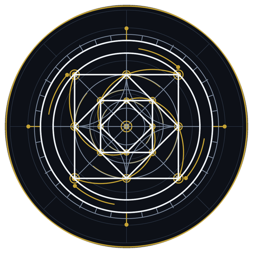
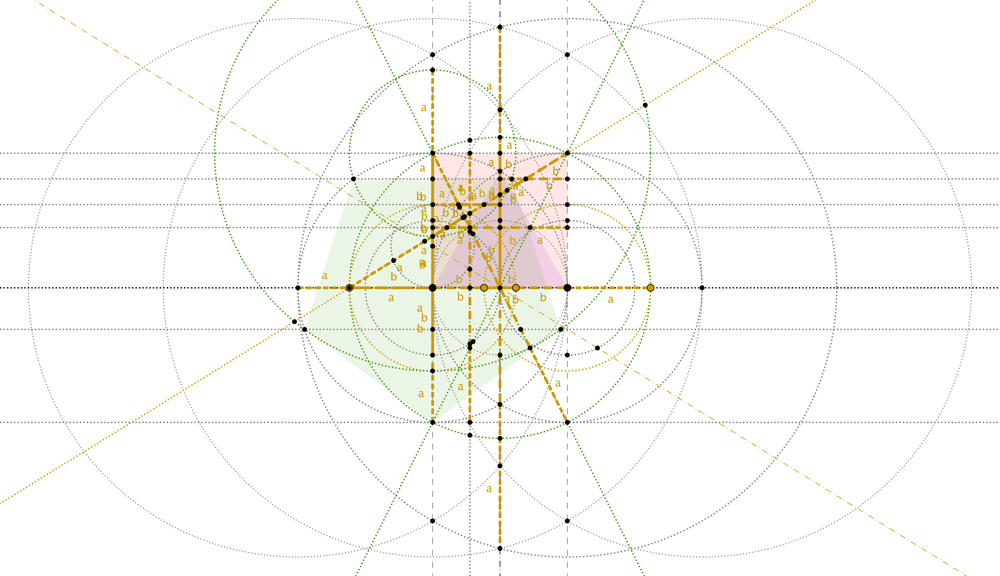

<a href="https://geometor.github.io/constructions/"></a>

# GEOMETOR • animations

**Visit the Online Archive:** https://geometor.github.io/animations/

<p align="center">
  <a href="https://geometor.github.io/animations/"></a>
</p>

**Geometric Animations • Proportional golden-section studies & root lattices**

## Mission

`geometor/animations` is part of the interconnected [GEOMETOR](https://geometor.com) semantic digital archive. It provides systematic compass-and-straightedge constructions, proportional studies, and step-by-step vector animations investigating unique golden sections across classical and root-system geometries. By isolating exact geometric incidences and sequences for print, web, and dynamic SVG playback, it liberates proportional discoveries into calibrated visual demonstrations across the GEOMETOR corpus.

## Capabilities & Interactive Docs

- [Geometric Animations](https://geometor.github.io/animations/) — Systematic compass-and-straightedge constructions and animated proportional studies.
- [Three Golden Sections](https://geometor.github.io/animations/) — Foundational studies isolating unique constructions where baselines section into golden proportions.
- [Root 3 & Root 5 Systems](https://geometor.github.io/animations/) — Proportional lattice investigations within square-root and diagonal grids.
- [Star Polygons & Cyclic Systems](https://geometor.github.io/animations/) — Cyclic star patterns and harmonic segment divisions.

## Repository Contents

- `docsrc/` — RST technical documentation and construction studies compiled by [PHOTON publish](https://github.com/photon-platform/publish).

## Local Build & Verification

```bash
publish build
```
## Part of the GEOMETOR Knowledge Archive

Explore all **74 Book Codices** and **11 Mathematical Catalogs** at https://geometor.com/books/.
