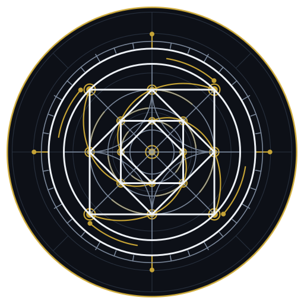

:site_title: Geometric Animations

.. container:: author-overline

   semantic digital archive • interactive studio

====================
Geometric Animations
====================

``geometor/animations`` is the dynamic construction and animation studio of the interconnected `GEOMETOR <https://geometor.com/books/>`_ semantic digital archive. It documents systematic compass-and-straightedge constructions and proportional systems exploring unique golden sections across classical and root-system geometries, isolating exact geometric incidences for print, web, and dynamic SVG playback.

Proportional Systems & Studies
------------------------------

* **Three Golden Sections**: Foundational studies seeking unique constructions where baselines section into golden proportions.
* **Root 3 & Root 5 Systems**: Proportional explorations within square-root and diagonal lattice grids.
* **Star Polygons & Sequences**: Cyclic star patterns and harmonic segment divisions.

----

Indices
-------

* :ref:`genindex`
* :ref:`search`
